# Parenting Bakes, Parent-First Personality Content

**Purpose:** editorial and research basis for the deeper result copy stored in
`src/data/types.json`. The result should make a parent feel seen and less alone first, offer one
realistic way to refill their own resources second, and only then talk about the child.

## What the research changes

Parents are not struggling only because they lack parenting knowledge. The U.S. Surgeon General's
2024 advisory names financial strain, time demands, children's health and safety, isolation,
technology, cultural pressure, and worry about children's futures as recurring stressors. Its 2023
U.S. data found 48% of parents said their stress was completely overwhelming on most days, versus
26% of other adults. These figures describe the U.S., not Indonesia, but the pressure categories are
useful prompts for relatable copy. [Parents Under Pressure, U.S. Surgeon
General](https://www.hhs.gov/surgeongeneral/reports-and-publications/parents/index.html)

Parental burnout is better framed as an imbalance between demands and available resources than as
a personal failure. The BR² model found that this risk-resource balance predicted burnout both
cross-sectionally and prospectively; its practical implication is that when one large stressor
cannot be removed, adding several smaller resources can still matter. The authors explicitly note
that intervention claims and cross-cultural adaptation require further research. [Mikolajczak &
Roskam, BR² framework](https://doi.org/10.3389/fpsyg.2018.00886)

This is locally relevant, not merely imported anxiety. A 2024 validation study involving 679
Indonesian parents found that the Indonesian Parental Burnout Assessment retained the original
four-factor structure and showed strong overall internal consistency. It validated a measurement
tool; it did not estimate national prevalence. [PBA validation in Indonesian
parents](https://doi.org/10.1016/j.mhp.2024.200372)

Guilt and shame need different treatment. Guilt can point to a behavior that can be repaired;
shame turns the event into an identity verdict: “I am a bad parent.” In an experiment with 167
parents, a brief self-compassion prompt reduced reported guilt and shame after recalling a difficult
parenting event. This supports language that combines accountability with kindness, not language
that excuses harmful behavior. [Self-compassion and challenging parenting
events](https://doi.org/10.1080/00223980.2018.1523123)

Care for the parent belongs before advice about the child. UNICEF and WHO's Caring for the
Caregiver approach links caregiver emotional well-being, confidence, stress management, self-care,
and social support with the capacity to provide nurturing care. [UNICEF, Caring for the
Caregiver](https://www.unicef.org/documents/caring-caregiver)

Parent regulation is relevant, but it should not be sold as a magic causal lever. A meta-analysis
of 53 studies found small associations between parents' emotion-regulation skills or difficulties,
parenting behavior, and children's regulation or adjustment, with substantial heterogeneity in
many analyses. That supports practical parent-regulation prompts while ruling out deterministic
claims. [Parent emotional regulation meta-analysis](https://doi.org/10.1177/01650254211051086)

Perfection is not the relationship goal. Parent-child mismatches happen; returning to a positive,
connected exchange is the useful skill. Repair research supports explicitly teaching a short
reconnection after a rupture, while remaining cautious about generalizing from specific laboratory
samples. [Parent-child repair processes](https://pmc.ncbi.nlm.nih.gov/articles/PMC5298208/)

The most recognizable parenting pressure often lives in repeated, ordinary friction rather than a
single dramatic crisis: getting ready for school, scheduling, housework, sibling conflict, whining,
and behavior that is hard to manage. These daily hassles are the right setting for the stories
because they let a parent recognize their life before receiving advice. [Parenting daily hassles
and preschool adjustment](https://doi.org/10.1016/S0885-2006(03)00045-0)

The ideal of special, uninterrupted “quality time” can itself create stress and guilt. Ethnographic
work with 32 dual-earner families found that chores and errands can contain unplanned “quality
moments” that still build relationships. The stories therefore end in small reconnections inside
ordinary life, not expensive or highly curated family activities. [Everyday
Moments](https://doi.org/10.1177/0961463X07080276)

An Indonesian study of 171 mothers found that parental screen guilt was shaped by the gap between
ideal digital-parenting standards and real-life screen practices. This supports scenes where guilt
is named as an inner verdict created by ideal-versus-reality tension, not treated as proof of a bad
parenting identity. The correlational study does not establish causation or represent all Indonesian
parents. [Parental screen guilt and subjective
well-being](https://doi.org/10.32734/psikologia.v21i1.24030)

Chronological narratives can increase transportation and, through transportation, reduce some
resistance to a message. Results vary substantially across samples, so storytelling is used here as
an empathy and comprehension device, not as a guaranteed persuasion mechanism. [Narrative structure
experiment](https://doi.org/10.1075/idj.20019.sie) · [heterogeneous narrative
effects](https://ijoc.org/index.php/ijoc/article/view/17446)

The practical layer remains non-clinical. WHO recommends evidence-based parenting interventions to
reduce harsh parenting, improve parent-child relationships, and support parent and child mental
health; a quiz result is not a substitute for those programs or professional care. [WHO parenting
intervention guideline](https://www.who.int/publications/i/item/9789240065505)

## Editorial contract

Every type gets the same narrative-first sequence and the same amount of care:

1. **Story**, open with a chronological daily-life scene: ordinary friction, hidden parent load,
   guilt thought, a parent-first pause, reconnection, and one restrained bake metaphor.
2. **Real life**, name the type-specific pressure without blaming the parent.
3. **Guilt release**, separate a difficult moment from the parent's identity while retaining room
   for repair.
4. **Care for you**, offer a small, accessible source of relief or joy, not an expensive wellness
   fantasy.
5. **For your child**, explain what the child may need only after the parent has been seen.
6. **Try this week**, three tiny actions in this order: parent resource, child connection, repair
   or support.

The presentation contract is **story first, summary points second**. The story must read as prose,
not disguised advice. The points below it stay concise and scannable so emotion turns into a usable
next step.

The 16 profiles below are **editorial interpretations** of the four research-informed dimensions.
They are not separately validated psychological types, diagnoses, or predictions of child outcomes.

## The 16 parent-first profiles

### PCTE, The Croquembouche

#### Cerita, Minggu yang Tidak Jadi Masterpiece

Jam 7.12 Minggu pagi, meja makan sudah penuh: potongan buah, botol minum, tiket museum, dan rencana utk membuat hari ini istimewa. Lalu hujan turun. Anakmu menolak ganti baju dan memilih masuk ke kardus bekas. Melihat semua persiapan itu, muncul satu vonis kecil: aku bahkan gak bisa bikin satu hari keluarga berjalan benar.

Sebagai orang tua Croquembouche, kadang rasanya seperti menyusun terlalu banyak kue kecil menjadi menara indah. Kamu membawa jadwal, bekal, keseruan, dan perasaan semua orang, lalu menyalahkan diri ketika satu bagian jatuh.

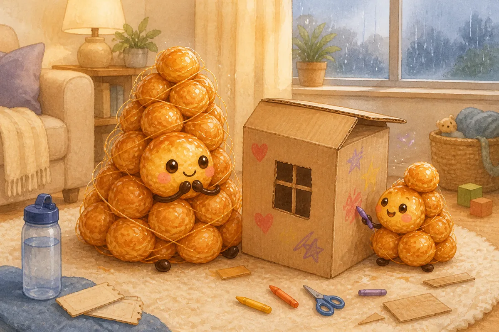

Pagi itu kamu gak menyelamatkan rencana. Kamu menjaga kopimu tetap hangat, membatalkan satu agenda, dan mengambil sepuluh menit yg gak perlu berguna atau layak di-posting.

Saat kembali, anakmu menyodorkan gunting. “Bantu bikin jendela?” Gak ada museum dan foto sempurna. Hanya jendela miring di kardus, tawa kecil, dan bahumu yg akhirnya turun. Mungkin anakmu gak membutuhkan hari yg lebih hebat. Mungkin kalian cuma perlu kamu kembali kepada dirimu sendiri dulu.

#### Kesimpulan

- **Real life:** Kamu sering jadi project manager keluarga: mikirin jadwal, bekal, pengalaman seru, dan perasaan semua orang sekaligus. Saat rencana berantakan, kamu bisa merasa gagal padahal kamu cuma sedang membawa terlalu banyak hal.
- **Guilt release:** Anakmu gak butuh setiap hari jadi masterpiece. Rencana yg gagal bukan bukti kamu orang tua yg gagal; itu cuma satu hari yg terlalu penuh.
- **Care for you:** Sisakan satu momen menyenangkan yg gak perlu berguna, edukatif, atau layak di-posting. Senang tanpa output tetap sah.
- **For your child:** Di balik semua pengalaman besar, anak paling mudah menangkap satu pesan sederhana: kamu tetap hadir ketika acaranya gak berjalan sesuai rencana.
- **Try this week:**
  - Batalkan satu agenda opsional
  - Ambil 10 menit utk sesuatu yg cuma kamu suka
  - Kalau tadi terlalu mengatur, bilang: “Tadi aku keburu tegang. Kita coba lagi bareng ya.”

### PCTN, The Lapis Legit

#### Cerita, Ketika Pagi Kehilangan Bentuknya

Senin biasanya punya urutan: bangun, sarapan, seragam, sepatu, lalu berangkat. Senin ini, susu tumpah, satu kaos kaki hilang, dan pesan sekolah bilang kelas mulai lebih awal. Jam 7.28 semua terlambat dan suaramu terdengar lebih tajam dari yg kamu mau. Pikiran itu langsung datang: aku merusak rutinitas aman yg susah payah kubangun.

Sebagai orang tua Lapis Legit, kamu mencintai lewat lapisan, ritual kecil yg ditaruh hati-hati, hari demi hari. Itu sebabnya satu lapisan miring terasa besar, padahal seluruh kuenya masih berdiri.

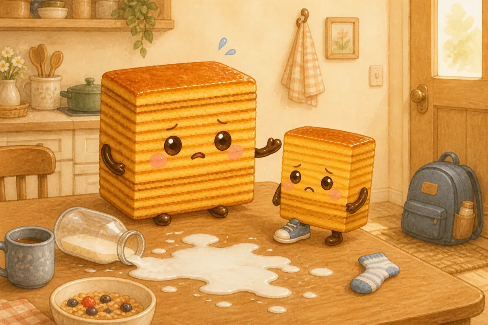

Kamu berhenti mencoba memperbaiki seluruh pagi. Sarapan berubah jadi roti di mobil. Satu tugas dibiarkan belum selesai. Kamu menarik satu napas pelan sebelum menyalakan mesin.

“Hari ini bentuknya berubah,” katamu, “tp kita tetap baik-baik aja.” Anakmu mengangguk dengan satu sepatu belum terpasang. Rutinitas bukan melindungi kalian dari kekacauan; hubungan kalianlah yg membuat kekacauan bisa dilewati. Satu pagi berantakan gak menghapus ratusan pagi biasa yg sudah mengajarkan rasa rumah.

#### Kesimpulan

- **Real life:** Kamu menjaga keluarga lewat rutinitas, tradisi, dan detail kecil. Karena banyak hal bergantung padamu, perubahan jadwal sedikit saja bisa terasa seperti kamu mengecewakan semua orang.
- **Guilt release:** Konsisten gak berarti selalu sempurna. Satu lapisan yg miring gak merusak seluruh kue, dan satu hari yg kacau gak menghapus rasa aman yg sudah kamu bangun.
- **Care for you:** Pilih satu rutinitas keluarga yg minggu ini boleh dibuat versi minimum. Energi yg tersisa bukan kemalasan; itu cadangan hidupmu.
- **For your child:** Anak membutuhkan pola yg cukup bisa diprediksi, sekaligus melihat bahwa rumah tetap aman ketika rencana berubah.
- **Try this week:**
  - Turunkan standar satu tugas
  - Jadwalkan jeda sebelum kalender penuh
  - Saat jadwal berubah, ucapkan: “Rencananya berubah, tp kita tetap aman.”

### PCDE, The Baguette

#### Cerita, Plester di Saku Depan

Di playground, anakmu terpeleset dari anak tangga paling rendah. Sebelum tangisnya penuh, kamu sudah membuka botol minum dan mengambil plester dari saku depan. “Gakpapa. Dibersihin, ditutup, terus main lagi.” Semua yg praktis beres kurang dari semenit. Tp anakmu tetap diam di sampingmu.

Di perjalanan pulang, rasa bersalah mulai menulis ulang adegan tadi: mungkin aku terlalu dingin. Mungkin orang tua yg lebih baik pasti tahu harus bilang apa.

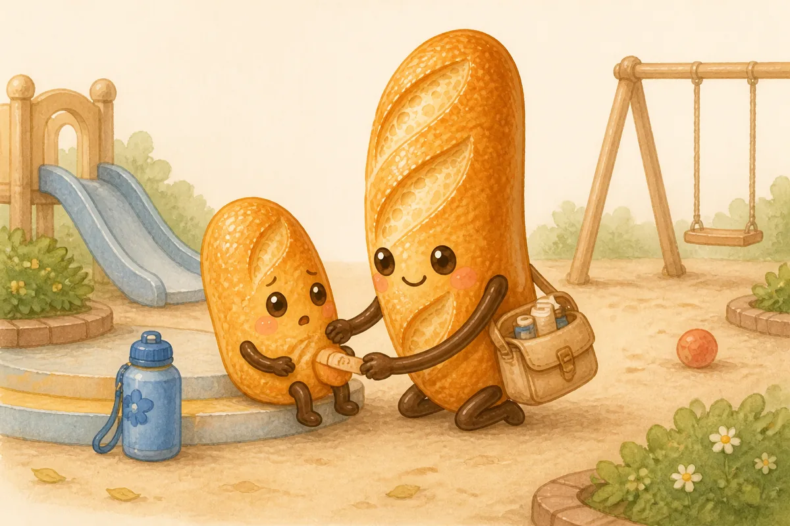

Sebagai orang tua Baguette, kamu menunjukkan cinta lewat kesiapan. Sayangmu sering berbentuk bekal, keputusan jelas, dan tangan yg sigap ketika sesuatu terjadi. Cinta itu nyata; ia cuma butuh satu jeda kecil di samping solusi.

Di lampu merah kamu menoleh. “Tadi jatuhnya bikin kaget ya?” Anakmu mengangguk dan akhirnya cerita betapa tinggi tangga itu terasa. Gak perlu pidato panjang. Plester merawat lututnya; satu pertanyaan merawat momennya. Kamu gak perlu menjadi orang tua yg berbeda. Cukup biarkan tanganmu yg cekatan datang setengah napas setelah hatimu.

#### Kesimpulan

- **Real life:** Kamu terbiasa menjadi orang yg tahu harus melakukan apa. Logistik beres, keputusan cepat, masalah ditangani, sampai kamu merasa bersalah karena gak selalu punya kata-kata lembut.
- **Guilt release:** Cinta gak cuma terdengar seperti percakapan panjang; sering kali ia berbentuk bekal yg siap dan tangan yg sigap. Kamu gak dingin, kamu hanya perlu menambahkan sedikit ruang sebelum solusi.
- **Care for you:** Serahkan satu keputusan kecil kepada orang lain. Kamu boleh berhenti menjadi pusat kendali tanpa membuat keluarga kehilangan arah.
- **For your child:** Sebelum kamu memperbaiki masalahnya, satu kalimat yg mengakui perasaan membantu anak merasa ditemani, bukan dikelola.
- **Try this week:**
  - Delegasikan satu urusan
  - Tarik satu napas sebelum memberi solusi
  - Coba: “Kamu kecewa ya, mau dipeluk atau dibantu?”

### PCDN, The Milk Bread

#### Cerita, Satu Anak Tangga Lebih Tinggi

Di pesta ulang tahun, anakmu memanjat rangka yg biasanya dipakai anak lebih besar. Tubuhmu bereaksi duluan: satu tangan terangkat, mata memeriksa tanah, dan tiga kemungkinan celaka muncul sekaligus. “Turun, itu gak aman.” Anakmu menoleh kecewa. Orang tua lain terlihat santai, dan rasa bersalah berbisik bahwa kamu terlalu mengontrol sekaligus kurang melindungi, entah bagaimana keduanya.

Sebagai orang tua Milk Bread, kamu menunjukkan cinta lewat antisipasi. Kamu membawa baju cadangan, snack cadangan, dan rencana B utk rencana B. Tp hidup terus dalam mode siaga membuat tubuhmu lupa seperti apa rasanya “cukup aman”.

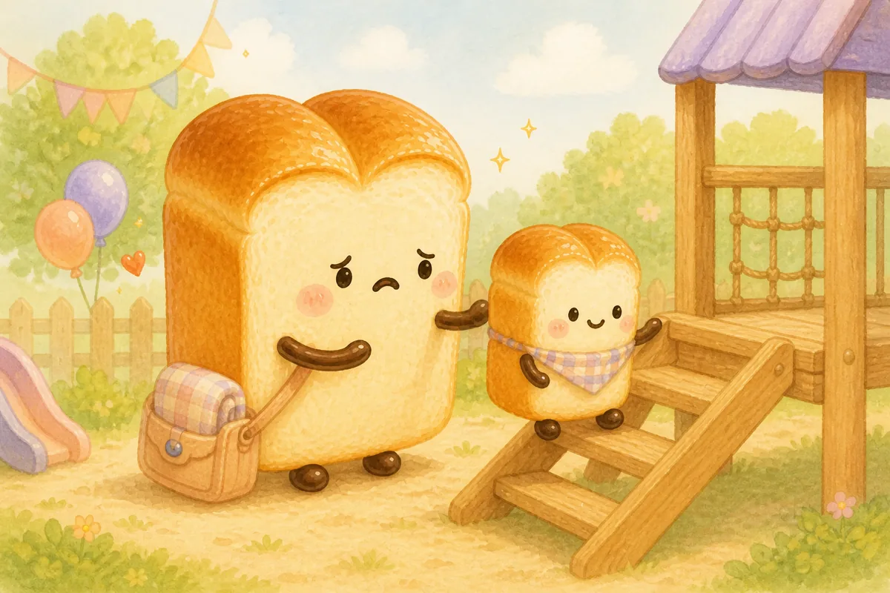

Kamu menurunkan tangan dan mendekat, bukan langsung menarik anakmu turun. “Coba satu anak tangga. Aku di sini.” Jantungmu masih cepat; keberanian gak harus terasa tenang.

Anakmu naik, goyah, lalu turun sambil tersenyum. Kamu gak menghapus semua risiko dan gak meninggalkan perlindungan. Kamu menjadi tempat lembut yg tetap dekat: cukup dekat utk menangkap, cukup jauh utk membiarkan pertumbuhan terjadi. Di perjalanan pulang, baru kamu sadar rahangmu gak lagi mengeras.

#### Kesimpulan

- **Real life:** Kamu menunjukkan sayang lewat antisipasi: makanan cadangan, jadwal aman, dan rencana B utk rencana B. Kewaspadaan itu melelahkan dan membuat kejadian kecil mudah terasa sebagai bukti kamu kurang melindungi anak.
- **Guilt release:** Tidak semua goresan, kecewa, atau ketidaknyamanan adalah kegagalan perlindungan. Menjaga anak juga berarti percaya bahwa ia bisa pulih dengan kamu di dekatnya.
- **Care for you:** Tentukan satu area yg boleh “cukup aman”, bukan “nol risiko”. Tubuhmu juga berhak keluar sebentar dari mode siaga.
- **For your child:** Anak membutuhkan basis yg aman dan kesempatan kecil untuk mencoba, goyah, lalu kembali kepadamu.
- **Try this week:**
  - Lepaskan satu pemeriksaan berulang
  - Lakukan aktivitas tenang tanpa multitasking
  - Tawarkan: “Coba dulu, aku ada dekat sini.”

### PGTE, The Cronut

#### Cerita, Gunung Meletus yang Berubah Jadi Dinosaurus

Meja makan masih penuh baking soda, cat merah, dan gunung kardus setengah jadi ketika anakmu masuk membawa buku dinosaurus. “Besok bikin ini ya?” Kemarin kamu sama semangatnya. Hari ini, melihat tiga eksperimen belum selesai dan satu pesan kerja, kamu berpikir: kita gak pernah menyelesaikan apa pun. Aku cuma bikin rumah makin kacau.

Sebagai orang tua Cronut, kamu paham resep lalu langsung ingin me-remix-nya. Rasa ingin tahu di rumahmu tumbuh cepat, menyeberang ke mana-mana, dan sering berubah arah tanpa izin. Itu bukan kegagalan. Kadang sebuah pertanyaan memang selesai ketika rasa takjubnya sudah terjawab.

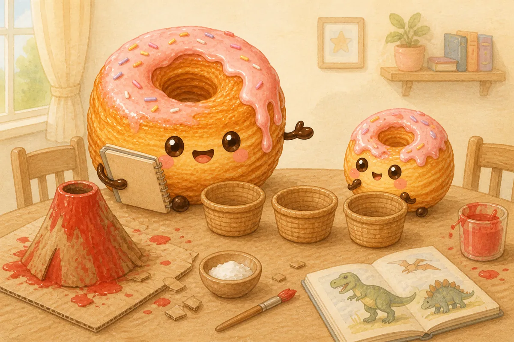

Sebelum membuat rencana baru, kamu mengambil lima belas menit dengan sketchbook milikmu sendiri, tanpa pelajaran, foto, atau output. Setelah itu kamu kembali membawa tiga pilihan: lanjutkan, simpan, atau lepaskan.

Anakmu memilih memotret gunung lalu mendaur ulang kardusnya. Dinosaurus bisa menunggu besok. Meja belum sepenuhnya bersih, tp satu cerita sudah punya akhir. Kamu menunjukkan bahwa bereksplorasi gak berarti menyimpan semuanya selamanya, dan permainanmu sendiri juga pantas punya ruang.

#### Kesimpulan

- **Real life:** Kamu mudah ikut bersemangat pada obsesi baru anak dan ingin mengubahnya jadi pengalaman yg kaya. Tumpukan proyek setengah jadi bisa membuatmu merasa gak konsisten.
- **Guilt release:** Rasa ingin tahu gak harus selalu menghasilkan karya jadi. Minat yg berpindah bukan bukti kamu gagal mendampingi; kadang eksplorasi memang selesai setelah rasa penasarannya terjawab.
- **Care for you:** Lakukan satu hal kreatif yg tidak berubah menjadi aktivitas anak, konten, atau target. Kamu juga boleh bermain.
- **For your child:** Anak mendapat manfaat dari kebebasan mengeksplorasi dan dari contoh sederhana tentang menutup, menyimpan, atau melepas sebuah proyek.
- **Try this week:**
  - Pilih satu proyek utk diselesaikan atau dilepas
  - Main 15 menit utk dirimu sendiri
  - Ajak anak bilang: “Kita lanjut, simpan, atau selesai sampai sini?”

### PGTN, The Pandan Chiffon

#### Cerita, Kata Tidak di Depan Rak Permen

Di kasir supermarket, anakmu minta permen. Kamu bilang tidak dengan lembut. Ia bertanya lagi, lebih keras. Semenit kemudian ia menangis di lantai sementara orang-orang melirik dari balik keranjang. Dadamu mengencang. Kalau aku benar-benar lembut, pikirmu, anakku gak akan sesedih ini.

Sebagai orang tua Pandan Chiffon, kamu cepat menangkap perubahan kecil di wajah anak. Kamu begitu alami memberi ruang utk perasaan sampai rasa kecewa anak terasa seperti bukti bahwa kamu menyakitinya. Tp kelembutan tanpa tepi akhirnya meminta kamu menghilang.

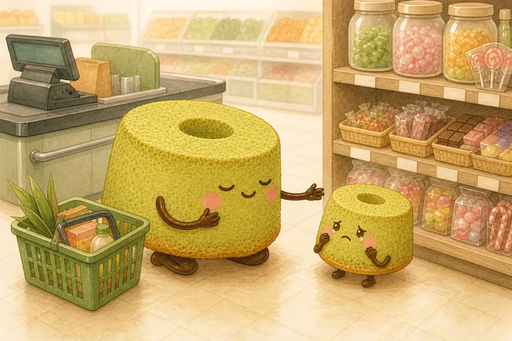

Kamu berjongkok, bukan utk mengubah jawaban, melainkan menenangkan dirimu sendiri. “Kamu pengin banget. Kamu boleh sedih, dan jawabannya tetap tidak.” Lalu kamu berhenti menjelaskan. Tubuhmu juga boleh punya batas.

Tangisnya gak langsung berhenti. Itu bukan bukti batasmu gagal. Di luar, anakmu menggenggam tanganmu dan bertanya soal hujan. Gak ada hubungan yg rusak. Kamu hangat dan tegas dalam momen yg sama, struktur lembut yg bisa mengembang tanpa ambruk.

#### Kesimpulan

- **Real life:** Kamu sangat peka terhadap sinyal anak dan ingin menjaga rumah tetap lembut. Karena itu, berkata tidak atau melihat anak kecewa bisa langsung terasa seperti kamu menyakitinya.
- **Guilt release:** Batas yg hangat bukan penolakan. Anak boleh kecewa dan tetap dicintai; kamu boleh tegas dan tetap menjadi orang tua yg lembut.
- **Care for you:** Hormati satu batas tubuh atau energimu sebelum habis. Kelembutan yg sehat juga berlaku untukmu.
- **For your child:** Anak membutuhkan empati sekaligus pagar yg jelas agar ia gak perlu menebak siapa yg memegang keadaan.
- **Try this week:**
  - Katakan satu “tidak” tanpa penjelasan panjang
  - Ambil jeda sunyi
  - Gunakan kalimat: “Kamu boleh sedih, dan jawabannya tetap belum.”

### PGDE, The Pretzel

#### Cerita, Sabtu Tanpa Misi

Sabtu pagi, ruang tamu tertutup mainan. Biasanya kamu bisa mengubah beres-beres jadi berburu harta, tantangan timer, atau misi penyelamatan. Hari ini tubuhmu berat. Anakmu menunggu permainan dimulai, dan rasa bersalah menepuk bahumu: kalau aku lebih hadir, pasti ini bisa kubikin seru.

Sebagai orang tua Pretzel, kamu suka mengubah aturan biasa menjadi permainan. Bergerak adalah caramu terhubung dan mencegah hari sulit terasa mandek. Tp terus menjadi mesin keseruan gak menyisakan tempat utk lelahmu sendiri.

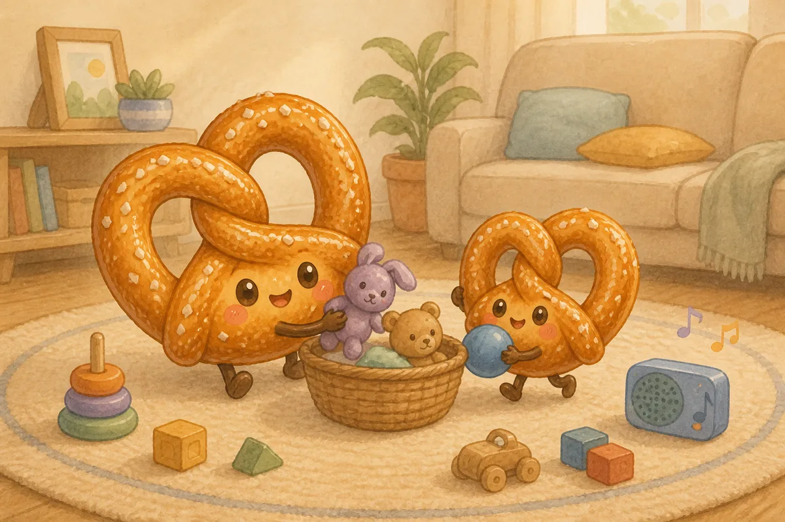

Jadi hari ini kamu membiarkan beres-beres tetap membosankan. Kamu memutar satu lagu utk dirimu, bergerak pelan, dan meminta semua orang mengembalikan lima barang. Gak ada storyline, pelajaran, atau kamera.

Setelahnya kalian duduk di lantai dan kamu bertanya, “Tadi bagian mana yg bikin kesal?” Anakmu menjawab, “Beres-beres.” Kalian tertawa. Hari itu gak perlu menjadi petualangan agar tetap berarti. Check-in kecil memberi akhir emosional pada momen biasa, sementara tubuhmu belajar bahwa koneksi tetap ada ketika kamu berhenti mempertunjukkannya.

#### Kesimpulan

- **Real life:** Kamu membuat hidup bergerak: beres-beres jadi permainan, belajar lewat praktik, dan masalah cepat berubah jadi misi. Saat hari berjalan biasa saja, kamu bisa merasa kurang hadir atau kurang kreatif.
- **Guilt release:** Anak gak membutuhkan setiap tugas jadi petualangan. Hari yg datar juga bagian dari masa kecil yg aman, kamu gak harus terus menjadi mesin keseruan.
- **Care for you:** Pilih gerak yg menyenangkan tubuhmu tanpa harus mengajak, mengajar, atau merekam siapa pun.
- **For your child:** Setelah aktivitas selesai, satu check-in singkat membantu pengalaman fisik menjadi pengalaman yg juga terasa secara emosional.
- **Try this week:**
  - Biarkan satu tugas tetap biasa
  - Gerakkan tubuh 10 menit utk dirimu
  - Setelah main, tanya: “Bagian mana yg seru atau bikin kesal?”

### PGDN, The Muffin

#### Cerita, Piring Hangat yang Terakhir

Saat makan malam, semua orang punya pilihan. Satu anak mau saus dipisah, yg lain minta gelas biru, dan seseorang menambah nasi tepat ketika kamu akhirnya duduk. Kamu bilang “boleh” berkali-kali sampai makananmu sendiri dingin. Ketika tiba-tiba kamu kesal gara-gara sendok jatuh, rasa bersalah datang sebelum permintaan maaf: kenapa aku marah padahal mereka gak minta banyak?

Sebagai orang tua Muffin, kamu menjadi wadah yg bisa diandalkan. Kamu memberi ruang, menawarkan pilihan, dan jarang minta jadi pusat. Tp kebutuhan gak hilang hanya karena ia diam; ia menunggu sampai kelelahan memberinya suara lebih keras.

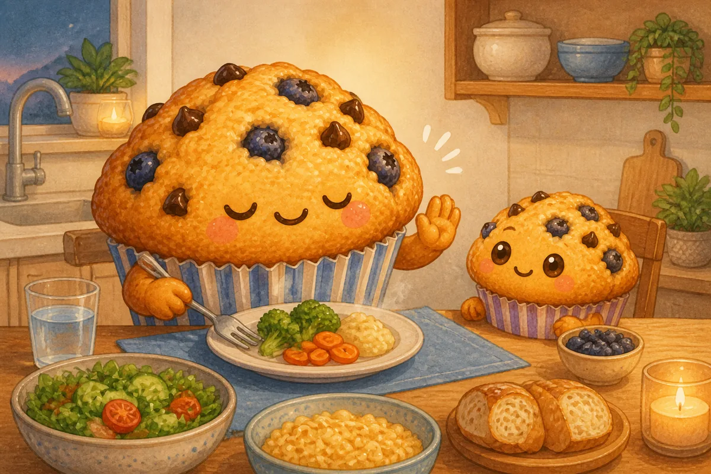

Kamu menghangatkan piring dan berkata tanpa minta maaf, “Aku makan dulu. Kasih aku lima menit ya.” Ruangan itu tetap aman. Cinta siapa pun gak berkurang.

Saat kembali ke sendok yg jatuh, kamu bilang, “Aku capek dan tadi bicara terlalu tajam. Itu bukan salahmu.” Anakmu ikut mengelap meja. Malam itu keluarga belajar sesuatu yg lebih besar dari kemurahan hati: rumah bukan tempat satu orang menghilang agar semua nyaman. Rumah adalah tempat semua orang, termasuk kamu, boleh hadir.

#### Kesimpulan

- **Real life:** Kamu memberi pilihan, menjaga suasana tetap tenang, dan jarang menuntut sorotan. Kadang kebutuhanmu hilang dari radar sampai kamu lelah atau mendadak kesal.
- **Guilt release:** Punya kebutuhan gak membuatmu egois. Mengatakan “Mama/Papa juga perlu…” justru membuat hubungan lebih jujur daripada terus mengalah lalu meledak.
- **Care for you:** Nyatakan satu preferensi kecil setiap hari tanpa meminta maaf karena memilikinya.
- **For your child:** Anak belajar bahwa keluarga bukan hanya tempat kebutuhannya diterima, tetapi juga tempat semua orang saling mempertimbangkan.
- **Try this week:**
  - Pilih sesuatu yg kamu mau
  - Minta bantuan secara spesifik
  - Katakan: “Aku sayang kamu, dan sekarang aku perlu lima menit sendiri.”

### FCTE, The Molten Lava Cake

#### Cerita, Setelah Bagian Hari yang Paling Terang

Sore itu dimulai dengan tarian spontan di tengah hujan. Kamu dan anakmu melompat di genangan, tertawa terlalu keras, dan selama satu jam kamu merasa jadi manusia paling hidup sedunia. Menjelang tidur, baju basah, suara ramai, dan tiga urusan belum selesai sudah mengosongkanmu. Ketika anakmu minta satu permainan lagi, suaramu meledak: “Cukup!”

Hening setelahnya terasa lebih buruk dari teriakan tadi. Sebagai orang tua Molten Lava Cake, kamu mengenal dua suhu, kegembiraan spontan di luar, perasaan intens di tengah. Rasa bersalah bilang perubahan energimu membuatmu gak aman. Tp stabil bukan berarti punya satu mood selamanya.

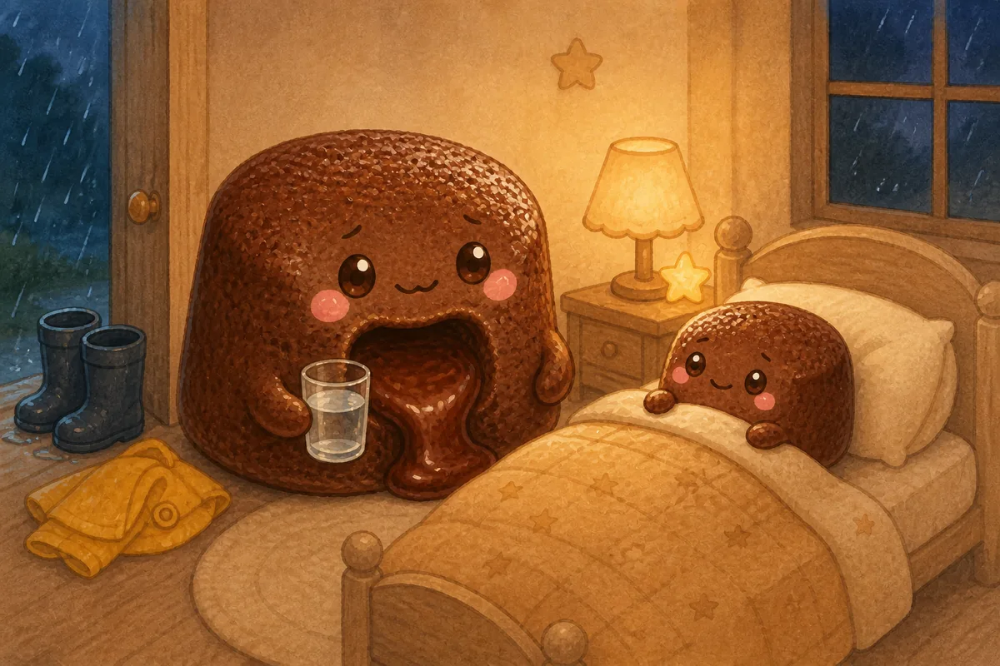

Kamu mandi, minum, lalu menghubungi seseorang yg bisa menampung bagian dewasa dari cerita ini. Setelah itu kamu kembali.

“Tadi suaraku terlalu keras. Itu tanggung jawabku, bukan salahmu.” Anakmu bersandar. Hari itu gak berakhir di ledakan; ia berakhir di kepulangan. Besok jangkar kalian sederhana: satu gelas air sebelum rutinitas tidur dimulai. Bukan rutinitas sempurna, cuma tempat bagi kalian berdua utk mendarat.

#### Kesimpulan

- **Real life:** Kamu membawa energi, spontanitas, dan perasaan yg besar. Saat energimu jatuh atau emosimu tumpah, kontrasnya bisa memicu rasa bersalah: “Kok aku gak konsisten?”
- **Guilt release:** Stabil bukan berarti selalu berada di mood yg sama. Anak bisa hidup dengan perubahan energi; yg penting mereka gak dibuat bertanggung jawab atas emosimu dan kamu kembali setelah momen sulit.
- **Care for you:** Bangun satu jangkar kecil yg tetap ada bahkan di hari kacau, minum, mandi, lagu, atau pesan kepada orang yg aman.
- **For your child:** Anak membutuhkan bahasa yg jelas bahwa ledakan atau lelahmu bukan salah mereka, lalu pengalaman nyata bahwa hubungan bisa diperbaiki.
- **Try this week:**
  - Pilih satu ritual jangkar
  - Cari satu tempat aman utk menumpahkan perasaan dewasa
  - Kalau meledak, bilang: “Tadi suaraku terlalu keras. Itu tanggung jawabku, bukan salahmu.”

### FCTN, The Cinnamon Roll

#### Cerita, Cerita Setelah Cerita Terakhir

Saat bedtime, satu cerita menjadi dua, lalu segelas air, lalu pertanyaan soal bulan. Kamu suka berat hangat tubuh anakmu di sampingmu. Kamu juga ingin mandi, punya sepuluh menit sunyi, dan merasakan tubuhmu milikmu lagi. Ketika buku ditutup dan kamu bilang, “Malam ini cukup,” air mata muncul. Rasa bersalah langsung menawarkan satu bab lagi.

Sebagai orang tua Cinnamon Roll, kamu membungkus ketidaknyamanan dengan kehangatan. Kamu tahu cara menenangkan, melembutkan, dan memberi ruang. Tp kenyamanan yg selalu menghabiskan sisa energimu lama-lama gak lagi terasa lembut.

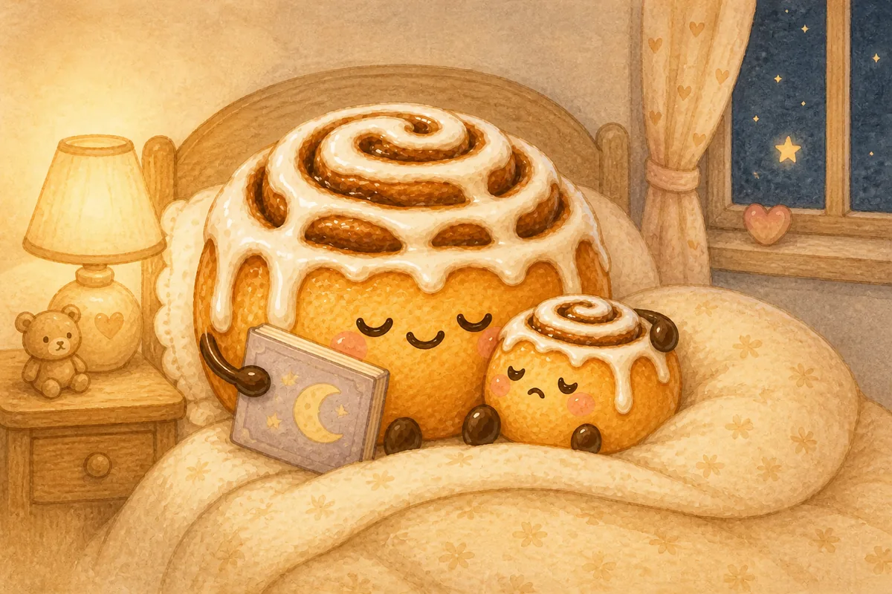

Malam ini kamu menjaga batasnya. “Aku tahu kamu mau satu lagi. Aku temani satu pelukan, dan ceritanya tetap selesai.” Kamu bernapas melewati protesnya tanpa menawar.

Setelahnya, air hangat mengalir di bahumu. Rumah itu gak menjadi kurang penuh cinta hanya karena ritualnya berakhir. Anakmu mengalami kecewa dan tetap ditemani; kamu memenuhi kebutuhanmu dan tetap menjadi orang tua yg peduli. Hangat dan tegas gak pernah berlawanan. Keduanya memang seharusnya berbagi oven yg sama.

#### Kesimpulan

- **Real life:** Kamu naluriah memberi pelukan, kelonggaran, dan kenyamanan. Kamu bisa merasa bersalah setiap kali perlu mengecewakan anak atau memilih kebutuhanmu sendiri.
- **Guilt release:** Membuat anak nyaman bukan satu-satunya bentuk cinta. Menahan batas yg masuk akal, meski anak protes, juga merupakan perawatan.
- **Care for you:** Tanyakan apa yg kamu inginkan sebelum otomatis membuat semua orang lain nyaman.
- **For your child:** Anak membutuhkan kehangatanmu, tetapi juga belajar bahwa rasa kecewa dapat dilewati tanpa batasnya harus hilang.
- **Try this week:**
  - Pertahankan satu batas kecil
  - Terima satu bantuan tanpa membalas
  - Katakan: “Aku tahu kamu pengin banget. Aku temani sedihnya, tp jawabannya tetap tidak.”

### FCDE, The Bagel

#### Cerita, Jeda Sebelum Membereskannya

Roda sepeda tersangkut trotoar dan anakmu jatuh dengan kedua tangan. Kamu mengangkat sepedanya, memeriksa telapak, membilas goresan, lalu berkata, “Gakpapa, yuk lanjut.” Seluruh masalah punya solusi. Tp anakmu gak mau memegang setang lagi.

Sebagai orang tua Bagel, kamu sudah melewati panas dan tahu cara terus bergerak. Kamu membuat momen sulit terasa lebih kecil, bisa ditangani, dan gak perlu dibesarkan. Di dunia parenting yg penuh istilah emosi, gaya langsung itu kadang membuatmu bertanya apakah ada yg kurang.

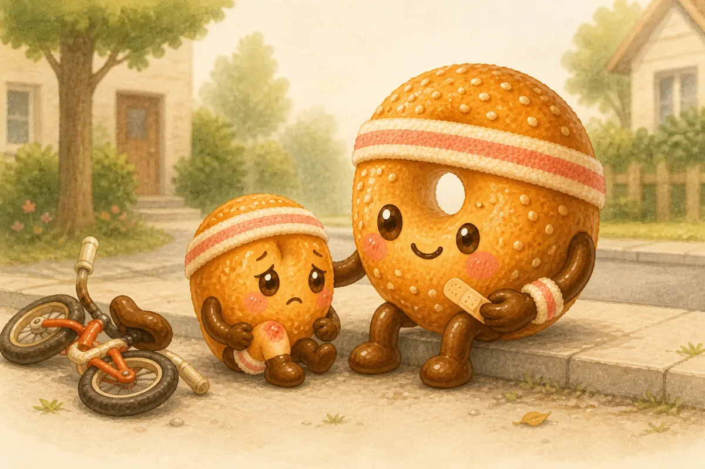

Kamu duduk di trotoar sebelum melakukan apa pun lagi. Satu napas. Gak ada yg dibereskan. “Tadi bikin takut ya.” Anakmu akhirnya mengeluarkan tangis yg ditahan.

Semenit kemudian, ia minta kamu memegang sepeda saat naik lagi. Perawatan praktis gak pernah salah; ia cuma datang sebelum perasaannya punya tempat. Kamu gak butuh pidato terapi. Satu kata jujur bisa menghubungkan tubuh, emosi, dan langkah berikutnya. Bahkan kamu pun boleh duduk sebentar di samping masalah sebelum mengubahnya jadi tugas.

#### Kesimpulan

- **Real life:** Kamu tangguh, praktis, dan gak suka membuat masalah lebih besar dari yg diperlukan. Di tengah budaya parenting yg penuh istilah, kamu bisa merasa kurang peka hanya karena gayamu lebih langsung.
- **Guilt release:** Anak gak membutuhkan pidato terapi setiap saat. Bantuan konkret adalah cinta; cukup tambahkan satu tanda bahwa kamu melihat perasaannya.
- **Care for you:** Berhenti sejenak sebelum mode “beresin” aktif. Kamu juga boleh merasakan sesuatu tanpa langsung mengubahnya jadi tugas.
- **For your child:** Satu kata emosi sebelum aksi membantu anak menghubungkan tubuh, perasaan, dan solusi.
- **Try this week:**
  - Tunda solusi selama satu napas
  - Lakukan sesuatu yg gak perlu diperbaiki
  - Coba: “Kaget ya. Kita duduk dulu, baru cari caranya.”

### FCDN, The Banana Bread

#### Cerita, Weekend yang Tetap di Rumah

Sabtu pagi, feed-mu menampilkan kelas renang, family hike, dan anak-anak melukis keramik. Di rumahmu, mesin cuci berputar, pisang mulai terlalu matang, dan semua masih pakai piyama. Anakmu membangun benteng dari bantal sofa. Ketakutan lama muncul: apa aku membuat dunianya terlalu kecil?

Sebagai orang tua Banana Bread, kamu tahu cara membuat kehangatan dari apa yg tersedia. Kamu menciptakan lelucon dari kerepotan, ritual dari sisa, dan rumah tempat orang bisa mengembuskan napas. Perbandingan membuat hadiah itu terlihat biasa karena gak bisa dihitung lewat kelas atau tiket.

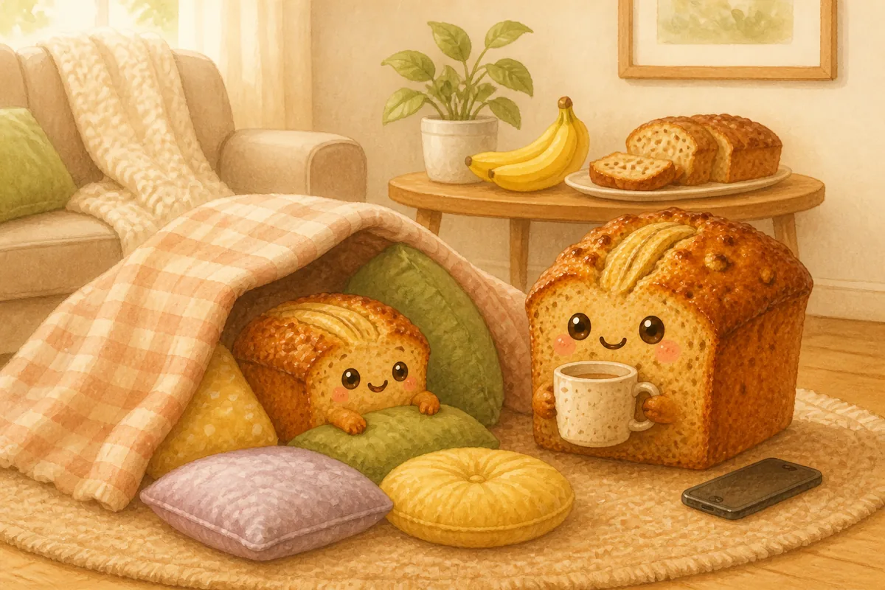

Kamu meletakkan ponsel dan memanggang pisangnya, bukan menghakiminya. Kamu makan satu potong ketika masih hangat. Sore harinya, kamu mengajak jalan lewat gang yg belum pernah dilewati; anakmu yg memilih kapan pulang.

Gak ada yg spektakuler. Kalian menemukan gerbang kuning, kucing tidur, dan jalan pintas baru. Hari itu tetap akrab sekaligus sedikit lebih luas. Masa kecil yg baik bukan koleksi aktivitas mengesankan. Kadang ia adalah home base yg aman dengan satu pintu kecil terbuka utk kejutan.

#### Kesimpulan

- **Real life:** Kamu jago membuat keadaan seadanya tetap terasa nyaman. Namun melihat keluarga lain yg lebih aktif atau terencana bisa membuatmu takut anak kehilangan pengalaman.
- **Guilt release:** Masa kecil yg baik gak diukur dari jumlah kelas, liburan, atau aktivitas. Rasa aman, humor, dan orang tua yg tersedia juga pengalaman besar.
- **Care for you:** Pertahankan kenyamanan yg benar-benar mengisi tenagamu, bukan kenyamanan yg cuma membuatmu terus menunda kebutuhan.
- **For your child:** Anak mendapat home base yg kuat darimu; sedikit kebaruan yg terukur membantu dunianya tumbuh tanpa menghilangkan rasa aman.
- **Try this week:**
  - Nikmati satu ritual rumah tanpa rasa bersalah
  - Pilih satu hal baru yg kecil
  - Biarkan anak menentukan kapan cukup

### FGTE, The Pavlova

#### Cerita, Ketika Kilau Membutuhkan Lantai

Dapur masih menyimpan glitter dari craft kemarin ketika anakmu bertanya, “Hari ini bikin cupcake dan undang semua orang yuk?” Biasanya kata iya keluar sebelum kalimatnya selesai. Hari ini kepalamu sakit, wastafel penuh, dan tersenyum pun terasa seperti tugas tambahan. Mengatakan tidak terasa seperti mematikan keajaiban dengan tanganmu sendiri.

Sebagai orang tua Pavlova, kamu mengikuti mata yg berbinar. Kamu membuat masa kecil terasa seperti perayaan karena kegembiraan memang penting bagimu. Tp gak ada orang yg bisa menjadi cuaca, dekorasi, dan musik setiap hari. Bahkan sesuatu yg ringan butuh alas yg kokoh.

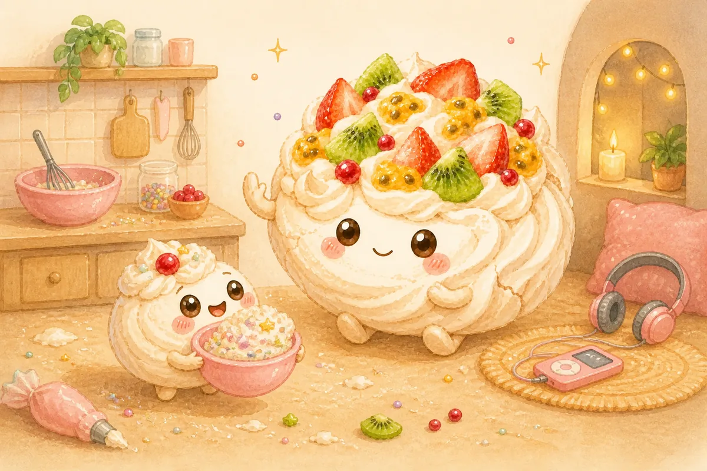

Kamu bilang, “Hari ini gak dulu,” dan membiarkan kekecewaan hadir. Lalu kamu memilih satu kesenangan privat: headphone, lagu favorit, dan sepuluh menit tanpa audiens.

Malamnya kamu menjaga hanya ritual keluarga yg benar-benar menahanmu, satu lagu tidur sederhana. Anakmu salah menyanyikan lirik dan kalian tertawa. Rumah itu gak kurang magis hanya karena gak ada cupcake. Kilau tetap tinggal karena berdiri di atas sesuatu yg bisa diandalkan, dan karena kegembiraan akhirnya boleh menjadi milikmu juga.

#### Kesimpulan

- **Real life:** Kamu suka mengatakan iya, mengikuti kilau mata anak, dan membuat rumah terasa hidup. Saat harus menolak, kelelahan, atau gak sanggup tampil ceria, kamu bisa merasa telah merusak keajaiban.
- **Guilt release:** Kamu bukan mesin perayaan. “Tidak hari ini” gak membatalkan semua kegembiraan yg sudah kamu ciptakan, bahkan sparkle butuh alas untuk berdiri.
- **Care for you:** Pilih kesenangan yg gak membutuhkan audiens dan gak perlu menjadi memori keluarga.
- **For your child:** Anak menikmati spontanitasmu dan terbantu oleh satu ritual yg tetap, terutama saat energi rumah berubah.
- **Try this week:**
  - Katakan tidak pada satu hal yg mengurasmu
  - Lakukan satu kesenangan privat
  - Jaga satu ritual sederhana seperti lagu tidur atau sarapan bersama

### FGTN, The Tiramisu

#### Cerita, Ketika Pelabuhan Mengambil Napas

Di perjalanan pulang, anakmu mulai cerita soal masalah pertemanan. Ponselmu punya tiga pesan kerja, makan malam belum direncanakan, dan percakapan sulitmu sendiri masih tertahan di dada. Kamu mendengarkan di setiap lampu merah sampai kata-katanya mulai kabur. Lalu rasa bersalah berkata: orang tua yg baik pasti masih punya ruang.

Sebagai orang tua Tiramisu, kamu menjadi pelabuhan utk setiap mood. Kamu menyerap suasana, melembutkan sudut tajam, dan membuat orang merasa didengar. Tp pelabuhan bukan seluruh lautan, dan mendengarkan tanpa punya tempat utk perasaanmu sendiri adalah cara lain utk menghilang.

Kamu parkir sebelum masuk rumah. “Aku mau dengar. Aku butuh lima menit sunyi supaya bisa benar-benar mendengarkan.” Kamu bernapas, mengirim satu pesan jujur kepada orang dewasa yg dipercaya, lalu membiarkan bahumu beristirahat.

Ketika kembali, anakmu masih ingin cerita. Kali ini kamu bisa mendengar kisahnya, bukan sekadar bertahan di tengah suaranya. Jeda itu bukan meninggalkan. Ia melindungi perhatian yg ingin kamu berikan, dan mengajarkan bahwa kedekatan juga boleh punya ruang bernapas.

#### Kesimpulan

- **Real life:** Kamu menyerap suasana dan menjadi pelabuhan untuk emosi semua orang. Lama-lama kamu bisa lelah, lalu merasa bersalah karena ingin sendiri atau gak sanggup mendengarkan lagi.
- **Guilt release:** Berjarak sebentar bukan meninggalkan anak. Kapasitas mendengarkan punya batas; menjaganya adalah bagian dari hubungan, bukan pengkhianatan terhadapnya.
- **Care for you:** Cari tempat di mana kamu gak harus menjadi penampung, teman, pasangan, ruang sunyi, atau bantuan profesional bila diperlukan.
- **For your child:** Anak membutuhkan empati, tetapi tidak perlu menjadikanmu satu-satunya regulator emosinya. Kehadiran yg tenang bisa berjalan bersama ruang untuk mencoba menenangkan diri.
- **Try this week:**
  - Lindungi 15 menit tanpa percakapan
  - Ceritakan kebutuhanmu pada satu orang dewasa
  - Katakan: “Aku dengar kamu. Aku tarik napas dulu, lalu kita lanjut.”

### FGDE, The Focaccia

#### Cerita, Lumpur di Handuk Bagus

Setelah sore di kebun, jejak lumpur melintasi lantai dan handuk bagus berubah cokelat di pinggirnya. Anakmu senang sekali. Seorang kerabat melihat sekeliling lalu berkata, “Rumah dibiarin begini?” Sesaat kepercayaan dirimu melipat. Mungkin kebebasan cuma nama lain dari kecerobohan.

Sebagai orang tua Focaccia, kamu percaya pada tangan, tanah, cuaca, dan salah coba. Kamu tahu belajar sering terlihat berantakan. Tp perbandingan dengan rumah yg lebih terkendali bisa membuat kelonggaranmu terasa seperti kekurangan.

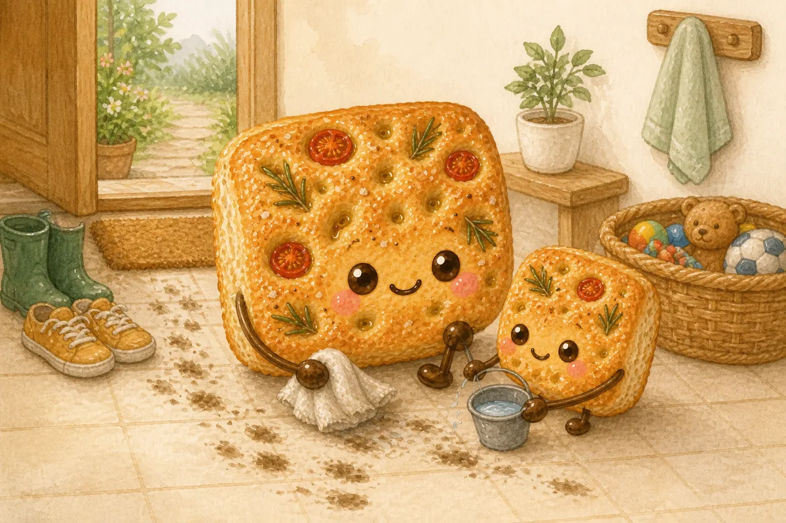

Sebelum membersihkan, kamu keluar sendiri selama tiga menit utk mencari udara. Lalu kamu kembali pada tiga aturan yg benar-benar penting: jaga tubuh, hormati orang, bantu rawat ruang bersama.

Kamu dan anakmu mengambil satu handuk lalu membersihkan satu jejak masing-masing tanpa ceramah. Rumahnya masih belum sempurna, tp tanggung jawabnya dibagi. Kebebasan gak hilang saat struktur datang; ia menjadi lebih aman. Seperti adonan yg pemaaf, keluargamu boleh ditekan, ditarik, dan dibentuk ulang tanpa menuntut semua permukaan selalu bersih.

#### Kesimpulan

- **Real life:** Kamu percaya anak belajar dari dunia nyata, tanah, air, tubuh, salah coba. Saat rumah berantakan atau orang lain lebih terstruktur, perbandingan bisa berubah menjadi rasa bersalah.
- **Guilt release:** Longgar bukan berarti lalai. Kamu gak harus meniru rumah lain; kamu hanya perlu beberapa batas yg benar-benar dijalankan.
- **Care for you:** Ambil waktu di luar atau bergerak tanpa mengubahnya menjadi sesi belajar anak.
- **For your child:** Kebebasan terasa lebih aman ketika anak tahu tiga hal yg tidak berubah: apa yg menjaga tubuh, menghormati orang, dan merawat tempat bersama.
- **Try this week:**
  - Pilih maksimal tiga aturan rumah
  - Cari udara luar utk dirimu
  - Sesudah kekacauan, ajak anak memperbaiki satu hal bersama tanpa ceramah

### FGDN, The Bolu Kukus

#### Cerita, Menara yang Dibangun Tanpa Bantuan

Anakmu sudah dua puluh menit membangun menara balok sendirian. Kamu duduk di dekatnya membalas satu email, lalu satu lagi. Di feed, seseorang sedang mengajarkan huruf lewat sensory play yg rumit. Rasa bersalah melihat ruangan sunyi itu dan bertanya: bukannya aku seharusnya melakukan lebih banyak?

Sebagai orang tua Bolu Kukus, kamu percaya pertumbuhan butuh ruang. Kamu menahan diri utk gak mengoreksi setiap gerak dan percaya anak bisa menemukan caranya. Di budaya yg menganggap stimulasi terus-menerus sebagai bukti cinta, kepercayaan yg tenang mudah disalahartikan sebagai ketidakhadiran, bahkan olehmu sendiri.

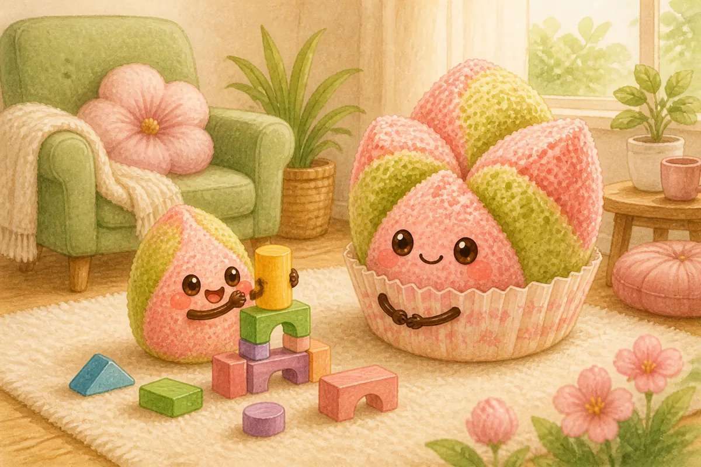

Kamu menutup laptop, tp gak mengambil alih. Pertama, kamu memakai lima menit dari ruang yg sudah kamu berikan utk mengistirahatkan mata. Lalu kamu duduk lebih dekat dan berkata, “Aku lihat kamu berusaha keras. Aku di sini kalau kamu butuh.”

Menaranya jatuh. Anakmu mengamati balok lalu mulai lagi tanpa meminta diselamatkan. Kamu bukan gak melakukan apa-apa. Kamu menyaksikan, mempercayai, dan tetap bisa dijangkau. Kehadiran gak selalu punya tangan yg sibuk. Kadang ia cuma uap hangat di sekitar sesuatu yg sedang belajar mekar sendiri.

#### Kesimpulan

- **Real life:** Kamu memberi anak ruang besar untuk menemukan caranya sendiri. Di tengah tekanan untuk selalu menstimulasi, mengajar, dan mengawasi, kamu bisa bertanya apakah kamu sudah “cukup melakukan”.
- **Guilt release:** Tidak mengintervensi setiap saat bukan berarti tidak peduli. Kepercayaan juga merupakan bentuk keterlibatan, selama anak tetap bisa merasakan kehadiranmu.
- **Care for you:** Gunakan sebagian ruang yg kamu berikan kepada anak untuk memulihkan dirimu, bukan diam-diam mengisinya dengan pekerjaan lain.
- **For your child:** Anak mendapat otonomi, sekaligus membutuhkan tanda sederhana bahwa kamu melihat, tertarik, dan siap membantu ketika diminta.
- **Try this week:**
  - Ambil satu jeda tanpa produktivitas
  - Amati sebelum membantu
  - Ucapkan: “Aku lihat kamu lagi berusaha. Aku di sini kalau kamu butuh.”
